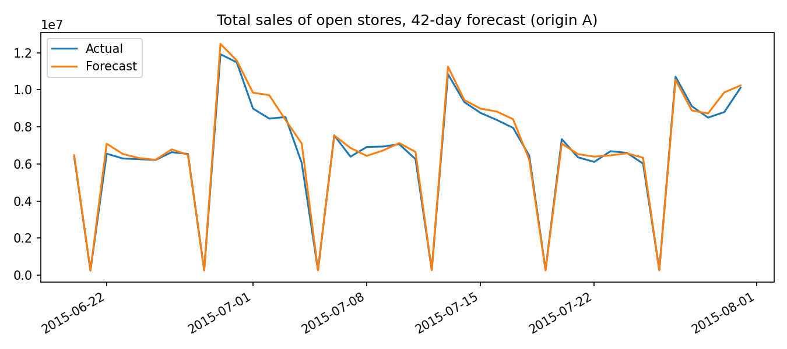
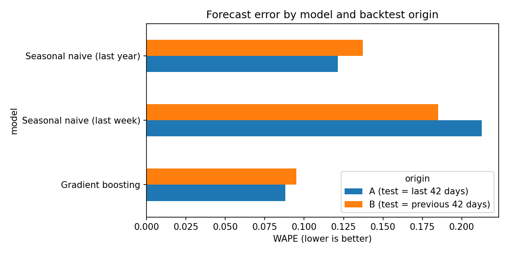
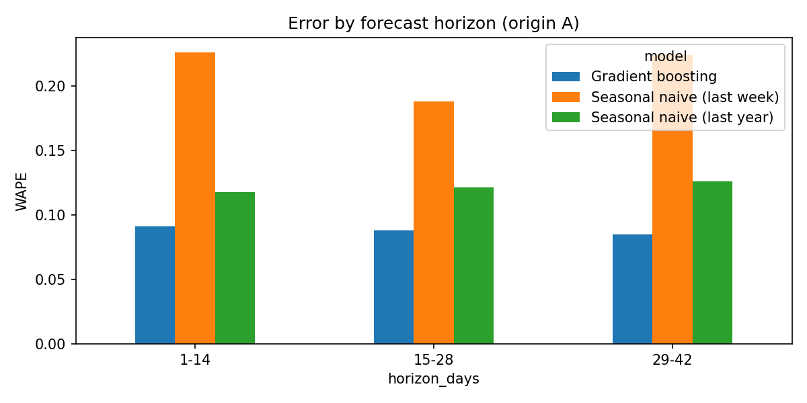
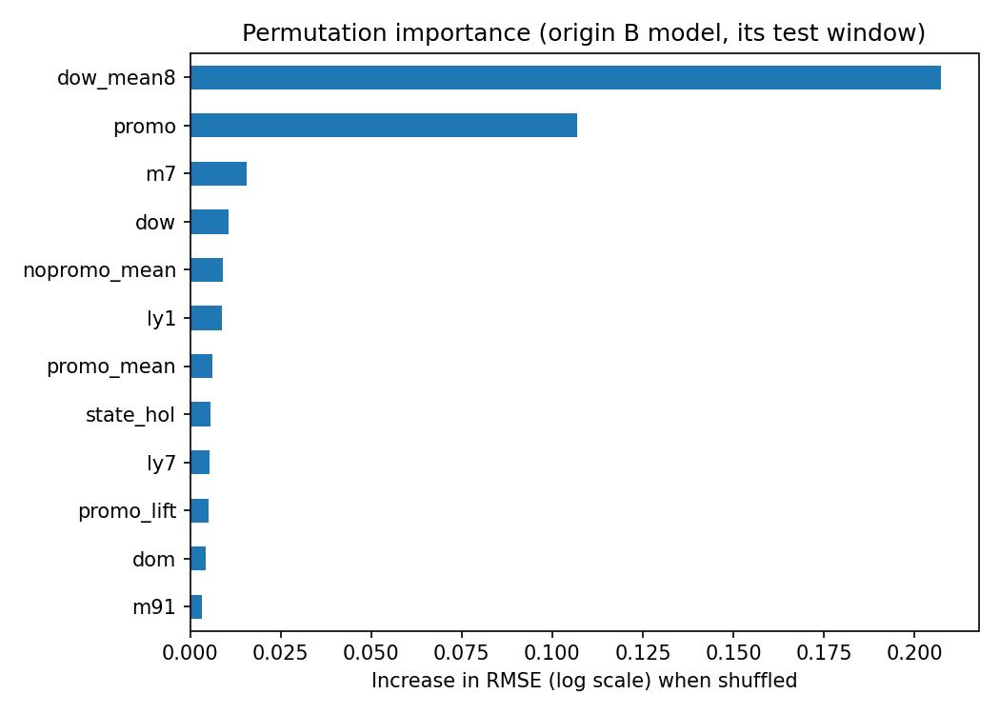
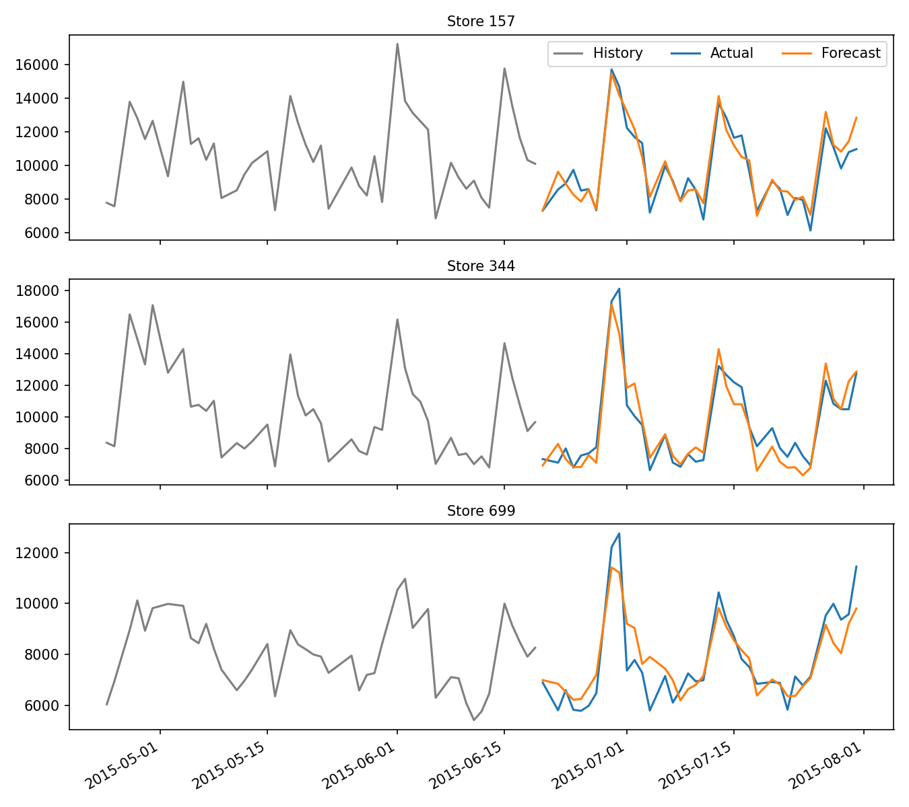

# Rossmann Store Sales: 6-week demand forecasting with time-based backtests

Forecasting daily sales of **1,115 Rossmann drugstores** for the next **42 days**, evaluated the way a forecast is used in practice: train only on the past, predict the following six weeks, and compare against simple baselines.

**Result:** a single global gradient boosting model reaches a **WAPE of 8.8% and 9.5%** on two separate 6-week test windows. That is **27–31% lower error** than the best seasonal-naive baseline (same day last year).



## Results

Metrics are computed on store-days when the store was open (Sales > 0). Two backtest origins:

| Model | WAPE (A) | RMSE (A) | RMSPE (A) | WAPE (B) | RMSE (B) | RMSPE (B) |
|---|---|---|---|---|---|---|
| **Gradient boosting (global, log sales)** | **0.088** | **900** | **0.132** | **0.095** | **955** | **0.134** |
| Seasonal naive: same day last year | 0.121 | 1,285 | 0.191 | 0.137 | 1,429 | 0.207 |
| Seasonal naive: same weekday last week | 0.213 | 2,083 | 0.349 | 0.185 | 1,799 | 0.303 |

- **A:** origin 2015-06-19, test 2015-06-20 → 2015-07-31 (40,282 store-days)
- **B:** origin 2015-05-08, test 2015-05-09 → 2015-06-19 (37,472 store-days)

**Comparison with ETS (Holt-Winters)** on a random sample of 60 stores. ETS is fitted separately for each store, which is too slow to run on all 1,115:

| Model (60-store sample) | WAPE (A) | WAPE (B) |
|---|---|---|
| **Gradient boosting** | **0.083** | **0.100** |
| Seasonal naive: last year | 0.122 | 0.141 |
| ETS Holt-Winters (damped trend, weekly season) | 0.193 | 0.170 |
| Seasonal naive: last week | 0.205 | 0.189 |

ETS only sees each store's own past sales, so it cannot know that next week has a promotion. In this data, promotions are the second most important driver of sales.

**Error by horizon (WAPE, gradient boosting)**

| Days ahead | 1–14 | 15–28 | 29–42 |
|---|---|---|---|
| Origin A | 0.091 | 0.088 | 0.085 |
| Origin B | 0.098 | 0.099 | 0.088 |

The error does **not** grow with the horizon. Most of the signal is the store's weekday pattern and the promotion calendar, and both are known in advance. Recent-level features matter less.

Other checks on the predictions:
- **Bias:** total forecast vs. actual is +2.7% (A) and +0.6% (B), so there is a slight over-forecast in window A.
- **Per store:** the median store has a WAPE of 8.5% (A) / 9.3% (B). 90% of stores are below 12%.




## Approach

**Task setup (direct multi-horizon).** At an origin day *t* (the last day with known sales), one model predicts every store's sales for *t+1 … t+42*. The horizon *h* is an input feature, so one model covers all 42 days.

**No leakage.** Every feature is something that would be known at the origin:
- sales history up to *t*: 7/28/91-day means, same-weekday mean of the last 8 weeks, promo vs. non-promo level and promo lift, short-term trend
- last-year sales for the target day (*target − 364 days*, always ≤ *t* because *h* < 364) and year-over-year growth
- calendar and plan information for the target day, which are known in advance: weekday, day of month, month, week of year, promotion, state and school holidays
- static store attributes: store type, assortment, competition distance, Promo2

**Model.** `HistGradientBoostingRegressor` (scikit-learn), trained on `log1p(Sales)` across all stores. Training rows come from many past origins (one every 14 days), keeping only targets that were already known at the test origin. That is about 2 million rows per backtest.

**Validation.** A rolling-origin backtest with two origins: the model is retrained for each origin using only data up to it. There is no random train/test split, because that would leak future information into the training set.

**Baselines.** The model only counts as useful if it beats simple rules:
- *same weekday last week*: this rule does poorly because Rossmann runs promotions in alternating weeks, so copying last week usually copies the wrong promotion state
- *same day last year*
- ETS (Holt-Winters) on a 60-store sample

**Data issues handled.**
- Closed days are excluded from the features and the metrics.
- 180 stores have a six-month gap in the data (2014-07-01 → 2014-12-31). The features are NaN-aware, so these stores stay in the dataset.
- 97% of stores never open on Sunday.

## What drives the forecast

Permutation importance on model B's test window. Each bar is the increase in RMSE (log scale) when one feature is shuffled:



The same-weekday mean of the last 8 weeks (`dow_mean8`) and the target day's promotion flag (`promo`) dominate. They are followed by the last 7-day level (`m7`), the weekday and the promo/non-promo levels.



## How to run

1. Download `train.csv` and `store.csv` from the Kaggle competition [Rossmann Store Sales](https://www.kaggle.com/c/rossmann-store-sales/data). The data is not included in this repo.
2. Install the packages and run the script:

```bash
pip install -r requirements.txt
python forecast_rossmann.py <folder with the csv files> results          # full run, ~3 min
python forecast_rossmann.py <folder with the csv files> results --fast   # quicker check
```

The script writes these files to `results/`:
- `metrics.csv`, `metrics_by_horizon.csv`
- `predictions.csv`
- `permutation_importance.csv`
- the figures shown above

## Limitations and next steps

- There are only two backtest origins. More origins, including the Christmas period, would give a more reliable error estimate.
- The model gives point forecasts only. Quantile models would give prediction intervals, which matter for stock decisions.
- Customer counts are not used, because they are not known in advance.

## Tech

Python · pandas · NumPy · scikit-learn · statsmodels · matplotlib
